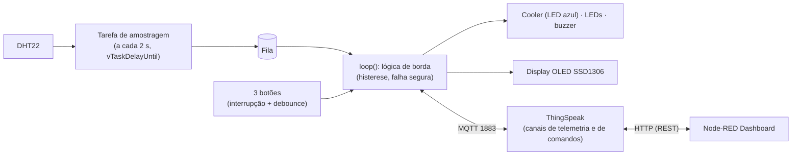

# ReAlimenta IoT — monitor de câmara fria (ESP32 + Wokwi + ThingSpeak)

Entrega de **Edge Computing & Computer Systems** — FIAP Global Solution 2026.2 (CitizenTech) — Grupo Orion.

## Integrantes

| Nome | RM |
|---|---|
| João Vitor Dutra de Freitas | _preencher_ |
| _preencher_ | _preencher_ |
| _preencher_ | _preencher_ |

## Contextualização

O **ReAlimenta** conecta organizações para doar e solicitar alimentos. Alimentos perecíveis só podem ser oferecidos com segurança se foram bem conservados. Este dispositivo monitora a **temperatura da câmara fria de quem doa** e a mantém na faixa correta, enviando os dados à nuvem para análise.

Faixas de operação (escopo do projeto):

| Temperatura | Estado | Ação |
|---|---|---|
| < 5 °C | NORMAL | LED verde |
| 5 a < 8 °C | ATENÇÃO | LED amarelo |
| ≥ 8 °C | CRÍTICO | LED vermelho piscando + buzzer; cooler ligado |

## Arquitetura



O diagrama da simulação está em **`diagram.json`** (abra no Wokwi).

### Hardware simulado e pinos

| Componente | Função | GPIO |
|---|---|---|
| DHT22 | Sensor digital de temperatura e umidade | 15 |
| OLED SSD1306 (I2C 0x3C) | Interface local | SDA 21 · SCL 22 |
| Botão MODO | Alterna AUTO → LIGADO → DESLIGADO | 18 |
| Botão PÁGINA | Alterna as páginas do display | 19 |
| Botão FALHA REDE | Simula queda de MQTT/WiFi (demonstração) | 4 |
| LED verde / amarelo / vermelho | Estado NORMAL / ATENÇÃO / CRÍTICO | 25 / 26 / 27 |
| LED azul | **Atuador**: cooler da câmara (no hardware real, um relé) | 33 |
| Buzzer | Alarme sonoro (crítico ou falha do sensor) | 13 |

## Requisitos da GS × implementação

| Requisito | Onde está |
|---|---|
| Leitura de sensor com amostragem **precisa e constante** | `src/sensor.cpp`: tarefa FreeRTOS com `vTaskDelayUntil` (sem deriva). Cada amostra carrega `periodUs`, o intervalo real, impresso na serial. |
| Atuador com lógica **processada na borda** | `src/actuator.cpp`: termostato com histerese, **falha segura** (sensor com defeito ou temperatura crítica mantém o cooler ligado) e alarme. |
| Display: valor atual, status do atuador, status WiFi/MQTT | `src/display_ui.cpp`, página 0 (veja "Tela local"). |
| MQTT: envio e recepção | `src/connectivity.cpp`: publica telemetria e assina o canal de comandos. |
| Plataforma back end com persistência | **ThingSpeak** (canais guardam o histórico; exportável em CSV/JSON). |
| Configuração/acionamento remoto | Setpoint e modo do cooler, pelo canal de comandos. Valores fora do limite são recusados. |
| Dashboard | **Node-RED** (`nodered/flows.json`), pois o front-end do ReAlimenta não exibe dados do dispositivo. |

## Plataforma IoT: ThingSpeak

**Canal 1 — "ReAlimenta Telemetria"** (dispositivo → nuvem), um envio a cada 20 s com a **média do período** (dado já processado na borda):

| Campo | Conteúdo |
|---|---|
| field1 | Temperatura média (°C) |
| field2 | Umidade média (%) |
| field3 | Cooler: 1 ligado, 0 desligado |
| field4 | Setpoint em uso (°C) |
| field5 | Modo: 0 AUTO, 1 LIGADO, 2 DESLIGADO |
| field6 | Estado: 0 NORMAL, 1 ATENÇÃO, 2 CRÍTICO, 3 FALHA NO SENSOR |
| field7 | Temperatura máxima no período (°C) |
| field8 | Sinal WiFi (RSSI, dBm) |

**Canal 2 — "ReAlimenta Comandos"** (dashboard → dispositivo): `field1` = setpoint (0 a 6 °C) · `field2` = modo (0, 1 ou 2).
Foram usados dois canais porque o plano gratuito aceita 1 atualização a cada 15 s por canal; assim um comando não é perdido por coincidir com o envio de telemetria.

**Dispositivo MQTT (device):** `mqtt3.thingspeak.com:1883`, autenticado por Client ID, usuário e senha do dispositivo, autorizado a publicar no Canal 1 e a assinar o Canal 2.

| Direção | Tópico |
|---|---|
| Publica | `channels/<ID_CANAL_1>/publish` com `field1=..&field2=..&status=MQTTPUBLISH` |
| Assina | `channels/<ID_CANAL_2>/subscribe/fields/field1` e `.../field2` |

### Configuração do ThingSpeak (uma vez)
1. Crie os dois canais (*Channels → New Channel*) com os campos acima. No Canal 1, marque *Make Public* se quiser ler sem chave.
2. Em *Devices → MQTT → Add a new device*, autorize os **dois** canais e guarde **Client ID, Username e Password** (a senha aparece uma vez).
3. Anote os **IDs** dos canais e a **Write API Key do Canal 2**.
4. Copie `include/secrets.example.h` para `include/secrets.h` e preencha. O `secrets.h` fica fora do Git (`.gitignore`).

## Opção mais simples: Wokwi pelo navegador
A pasta **`wokwi-web/`** é uma cópia do projeto em estrutura plana (`sketch.ino`, `.h`, `.cpp`, `diagram.json`, `libraries.txt`) para abrir direto em wokwi.com, sem instalar nada. O passo a passo completo, para quem nunca usou IoT, está em `GUIA_PASSO_A_PASSO.txt`.

## Como executar (VSCode + PlatformIO + Wokwi)
1. Instale as extensões **PlatformIO IDE** e **Wokwi Simulator** no VSCode (a Wokwi pede a licença gratuita).
2. Abra esta pasta, rode **PlatformIO: Build** (gera `.pio/build/esp32dev/firmware.bin`).
3. Abra `diagram.json` e clique em **Start Simulation**. A serial mostra `[SENS]`, `[MQTT]`, `[CMD]` e `[BTN]`.
4. Para alterar a temperatura, clique no DHT22 e arraste o controle de temperatura.

## Tela local (OLED 128×64)

**Página 0 (padrão)**
```
ReAlimenta             NORMAL     <- estado (NORMAL / ATENCAO / CRITICO / SENSOR!)
4.2C                              <- valor atual da temperatura
Umid:60%  Cooler:ON               <- umidade e status do atuador
WiFi:OK MQTT:OK                   <- status de conexão (OFF quando caiu; "SIM" = falha simulada)
```
**Página 1 (configuração):** setpoint, histerese, modo, limites de alerta, segundos desde o último envio e motivo do último reset (POWER, WDT...).

| Botão | Ação |
|---|---|
| MODO (verde) | AUTO → LIGADO → DESLIGADO |
| PÁGINA (azul) | Alterna página 0 e 1 |
| FALHA REDE (vermelho) | 1º clique: MQTT cai · 2º: WiFi cai · 3º: normaliza |

## Dashboard Node-RED
1. No Node-RED, instale a paleta **node-red-dashboard**.
2. *Import* → `nodered/flows.json`.
3. Abra o nó **CONFIGURAÇÃO** e preencha os IDs dos canais, a Read Key (se o canal for privado) e a **Write API Key do Canal 2**. *Deploy*.
4. Painel em `http://localhost:1880/ui`: gauge, gráfico, umidade, cooler, estado, setpoint e modo atuais, **status ONLINE/OFFLINE** (offline = sem dado há mais de 60 s) e os controles de setpoint e modo.

## Qualidade de software

- **Arquivos e módulos:** `sensor`, `actuator`, `buttons`, `display_ui`, `connectivity`, `watchdog`, cada um com `.h` e `.cpp`; `config.h` concentra pinos, tempos e limites; `types.h` concentra os tipos.
- **`enum class`:** `TempState`, `CoolerMode`, `LinkState`, `FaultSim`, `ButtonEvent`, `CommandType`.
- **`struct`:** `Sample`, `Settings`, `ActuatorStatus`, `Telemetry`, `RemoteCommand`, `UiModel`.
- **Contra o `delay()`:** nenhum `delay()` no projeto. A amostragem usa `vTaskDelayUntil`; o `loop()` usa `millis()` para display, publicação e reconexões.
- **Watchdog:** *task watchdog* de 10 s (`src/watchdog.cpp`) vigiando o `loop()` e a tarefa do sensor; estouro reinicia o chip. O motivo do reset aparece na página 1. Para demonstrar, descomente `-DWDT_TEST_HANG` em `platformio.ini`: aos 40 s o `loop()` trava e o chip reinicia mostrando `Rst:WDT`.
- **Botões:** interrupção `FALLING` + debounce por tempo dentro da ISR (50 ms); a ISR só enfileira o evento, tratado no `loop()`.
- **Reconexão sem travar:** máquina de estados WiFi → MQTT com intervalos de tentativa. Sem rede, o dispositivo **continua medindo e controlando** o cooler localmente. O `connect()` do MQTT tem tempo limite de 3 s, menor que o watchdog.

## Roteiro da gravação do vídeo (tela do simulador + dashboard)
1. **Operação normal:** simulação rodando, display na página 0, serial com `[SENS]` e `periodo=2000.000ms`.
2. **Alterar valores:** com o DHT22, leve a temperatura 4 → 6 → 9 → 3 °C. Mostre a cada passo o **display**, os LEDs, o cooler e o buzzer.
3. **Dashboard:** aguarde o envio (até 20 s) e mostre o Node-RED atualizando, com o gráfico.
4. **Configuração remota:** no dashboard, mude o setpoint (ex.: 2,0 °C) e o modo; mostre `[CMD]` na serial e a página 1 do display.
5. **Desconexão:** botão FALHA REDE: 1º clique, display `MQTT:OFF`; 2º clique, `WiFi:OFF`. Aguarde mais de 60 s para o dashboard mostrar **OFFLINE**, enquanto o display continua medindo. 3º clique: volta ao ONLINE.
6. **(Opcional) Watchdog:** build com `-DWDT_TEST_HANG` e o reset com `Rst:WDT`.

## Dados para o programa em Python
O histórico fica no ThingSpeak e pode ser baixado: `https://api.thingspeak.com/channels/<ID_CANAL_1>/feeds.csv?results=8000` (acrescente `&api_key=<READ_KEY>` se o canal for privado).

## Solução de problemas
- **Erro de pino no Wokwi:** se um fio aparecer vermelho, os nomes dos pinos da placa (`esp:GND.1`, `esp:GND.2`, `esp:3V3`) podem variar; arraste o fio para o pino correto no editor.
- **`#error ... secrets.h`:** copie `secrets.example.h` para `secrets.h`.
- **MQTT não conecta:** confira Client ID, usuário, senha e se o dispositivo está autorizado nos dois canais.
- **Comando sem efeito:** o ThingSpeak ignora atualizações com menos de 15 s de intervalo no mesmo canal.

## Limitações
- O botão FALHA REDE existe só para a demonstração; num produto real seria removido.
- Sem rede, os envios do período são descartados (não há fila de reenvio).
- Credenciais em `secrets.h`; num produto real, usar provisionamento seguro e TLS (porta 8883).
